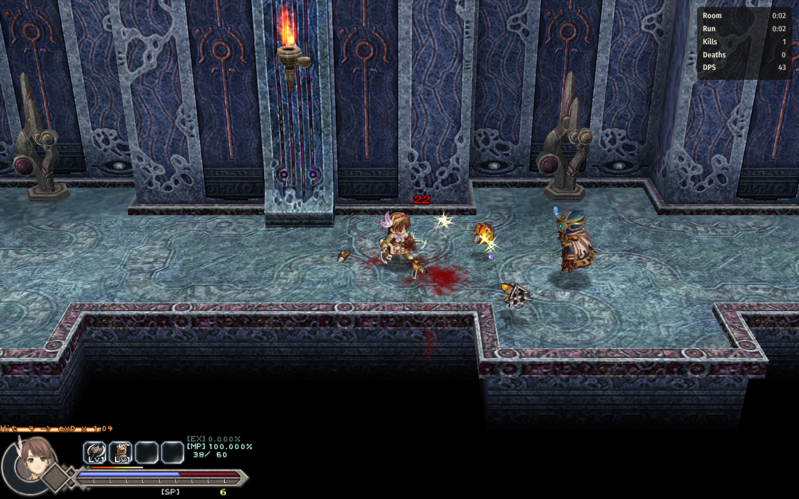

# Run HUD

The numbers of your **Ys Origin** run on CleriaCore, in a small panel: time in the room, time in the game, kills,
deaths and damage per second. Everything is kept with the save, and a recap card appears when the final boss falls.



- **Room / Run**: play time in this room and in this save. Cutscenes and text boxes do not count.
- **Kills / Deaths**: counted per save. A death stays counted after a Retry.
- **DPS**: your damage over the last five seconds.
- **F1 > Mods > Run HUD** shows the full list for the save: damage dealt and taken, hits taken, best single hit,
  bosses beaten, rooms entered. The panel's corner and the DPS line are settings there.
- **Recap**: when Dalles (Yunica, Hugo) or Darm (Toal) is beaten, a card sums the run up.

The mod only watches. It changes no number of the game.

## Install

1. Download `4rtefakt.runhud-1.0.0.cleriamod` from the [releases](../../releases).
2. Double-click it (or use F1 > Mods > *Install a mod file...*).
3. Turn **Run HUD** on in F1 > Mods and restart CleriaCore.

Needs a CleriaCore with mod API 6.

## How it works

One Lua file, [main.lua](main.lua). The interesting part is that a combat filter can be used as a probe: it
receives every hit just before it is applied, and answering `nil` leaves the game's value alone.

```lua
cleria.combat.add_filter("damage", function(q)
    local v = math.floor(q.value)
    if q.dir == "dealt" then
        run.dealt = run.dealt + v
        window[#window + 1] = {now, v}          -- the last five seconds, for the DPS
    elseif q.dir == "taken" then
        run.taken = run.taken + v
    end
    return nil                                  -- pass: this mod changes nothing
end)
```

| Part | API |
|---|---|
| Damage dealt and taken, DPS | the `"damage"` combat filter |
| Kills, deaths, bosses, rooms | the events `enemy_killed`, `death`, `boss_defeated`, `room_enter` |
| The clocks | the `tick` event, paused while `cleria.game.frozen()` |
| Kept with the save | `cleria.save.set("run", table)`: a table is stored as it is |
| The panel, the page | `cleria.hud.layer`, `cleria.ui.page`, `cleria.settings` |

## Tests

`python .dev/run.py` runs three cases through CleriaCore's headless harness: a monster is killed and the player is
hit (the panel's numbers must match the engine's: 90 dealt, 22 taken, best hit 30), a death and a Retry (the death
stays counted), and a save and load followed by a door (the totals come back, the room clock restarts).

Not covered: the recap card needs a final boss kill, which no test plays; it is checked by reading only.

## About

Written with AI assistance (Claude Code) as a showcase of the CleriaCore mod API, and tested as described above.
MIT license.
